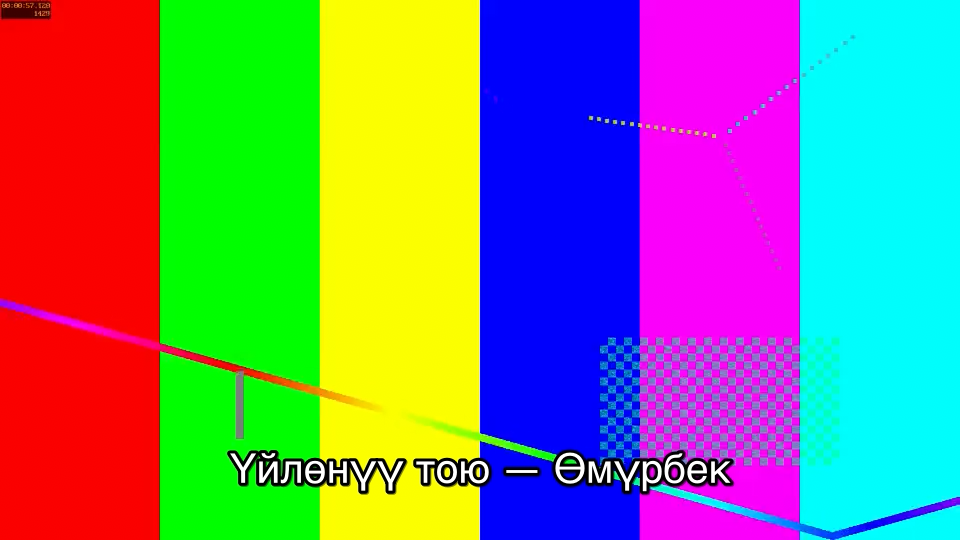

# S2 — плеер mpv в PySide6

**Вопрос.** Годится ли libmpv как плеер черновика в редакторе? Плеер встраивается в окно PySide6 и играет склейку `edl://` из ~200 коротких отрезков proxy-файлов. Он должен играть стыки без пропусков и чужих кадров, быстро перематывать, быстро пересобирать EDL после правки, шагать по кадрам, подмешивать музыку без сдвига звука и показывать титры с кириллицей. Отдельный вопрос — лицензия сборки libmpv.

**Короткий ответ.** На Mac (render API) **все пороги пройдены**: шаг назад и шаг вперёд — с запасом 25–30 мс, остальное — с большим. Решение **предварительное** до прогона на Windows. Пройдены они при пяти обязательных условиях. Без любого из них часть порогов проваливается:

1. **Начало отрезка в EDL ставится на 100 мкс раньше pts первого кадра.** Если начало стоит ровно на pts, перемотка на первый кадр отрезка попадает не на тот кадр в **134 из 200** отрезков (в 94 из них и `time-pos` на кадр позже). С упреждением — **0 из 200**.
2. **Декодирование proxy — программное (`hwdec=no`).** С videotoolbox декодер пересоздаётся на каждом стыке: 107 пропущенных кадров за 5,8 мин, шаг назад до 479 мс. Для 540p программный декодер дешёвый: 0 пропусков.
3. **Render API без блокировки: `block_for_target_time=0`.** С блокировкой (по умолчанию в mpv) `paintGL` спит до времени показа кадра. Тогда новый кадр после `frame-step` **появляется на экране через 132 мс (max)** — порог 100 мс не пройден. Без блокировки — 75 мс.
4. **На macOS процесс держит «активность» `NSProcessInfo`** (user-initiated + latency-critical), пока идёт воспроизведение. Иначе через ~20 с macOS усыпляет процесс (App Nap) и отбрасывается до трети кадров.
5. **GL-контекст — 4.1 core на macOS, а `lavfi-complex` — только для звука.** Без этого mpv отключает хорошие скейлеры и interop, а аппаратное декодирование уходит в режим copy.

Предварительно в продукт идёт **mpv**. Запасной план QtMultimedia не запускался: mpv на Mac прошёл все пороги. Встраивание по результату Mac — **render API**, окончательно решаем после прогона на Windows (команды в конце). Лицензия: Homebrew-сборка на Mac — **GPL**. LGPL-сборка libmpv для Windows **есть готовая** — `mpv-dev-lgpl-x86_64-*.7z` от zhongfly/mpv-winbuild. Есть и официальный рецепт сборки: `-Dgpl=false`.

Все цифры ниже — **Mac, не для решения** (Apple M1, 8 ГБ, macOS 27, mpv 0.42.0 / FFmpeg 9.0.2 из Homebrew, экран 60 Гц, Retina). Решение по производительности принимается по прогону на эталонном Windows-ПК.

## Что мерили

- **Исходники и proxy.** `generate_set` даёт три клипа по 60 с: 25, 30000/1001 и 50 к/с, 1080p, белая вспышка в один кадр и писк 1 кГц в моменты 1 + 2k с. Из них сделаны proxy по §5 (`spikes/s2_player/prepare.py`): 960×540, H.264 High@4.0, CRF 26, GOP = 1 с (`-g` = round(fps), без scene-cut), 2 B-кадра, CFR с частотой исходника, теги BT.709, AAC 48 кГц стерео. Параметры кодека у трёх файлов одинаковые, отличается только частота кадров. Это намеренно: у камер на тое частоты разные, и EDL должен склеивать 25, 29,97 и 50 к/с.
- **EDL.** 200 отрезков по 0,5–3 с (среднее 1,73 с), всего 345,3 с и 12 095 кадров, seed = 2 (`timeline.make_segments`). Резы стоят на границах кадров исходника, не ближе 60 мс к вспышке или писку и не в последней секунде файла. Соседние отрезки никогда не продолжают друг друга, так что каждый стык — настоящий рез. Строка `edl://` занимает 19 594 символа. Пути записаны в форме `%<байты UTF-8>%путь`, поэтому кириллица, пробелы и запятые в пути безопасны. Рабочая папка — `spikes/data/s2/Той Студия/`.
- **Плеер.** `render_widget.py`: `QOpenGLWidget` + `MpvRenderContext`, `vo=libmpv`, `block_for_target_time=0`. Колбэк обновления mpv только шлёт Qt-сигнал, `render()` вызывается из `paintGL` в GUI-потоке. Опции: `keep-open`, `hr-seek=yes`, `hwdec=no`. Музыка подключается как `audio-files=music_bed.wav` + `lavfi-complex=[aid1][aid2]amix=inputs=2:duration=first:normalize=0[ao]`. Это 120-секундный трек, закольцованный на длину EDL, громкость 0,25, PCM.
- **Бенчмарк.** `bench_player.py --mode render` открывает окно поверх остальных (видео ровно 960×540 точек), гоняет mpv из рабочего потока и сам выходит. Человек не нужен. Шаги:
  1. **control_lead0 / control_lead100** — без окна: точная перемотка на первый кадр каждого из 200 отрезков, когда начала стоят ровно на pts и когда стоят с упреждением 100 мкс. Проверяются `time-pos` и `screenshot-raw` против кадра от ffmpeg;
  2. **playback** — воспроизведение всего EDL в реальном времени;
  3. **seams** — проверка каждого стыка;
  4. **seek**, **frame_step**, **rebuild**, **titles**;
  5. **playback_after** — ещё 60 с воспроизведения после всех перемоток;
  6. **sync** — без окна: тот же EDL с той же музыкой кодируется собственным конвейером mpv (`o=`, encoding mode), затем по файлу работают `detect_flashes` и `detect_beeps`;
  7. **seam_audio** — без окна: тот же EDL поверх копий proxy, в звуке которых добавлен непрерывный тон (резы падают на середину волны). Encoding mode mpv, затем каждый стык сравнивается с идеальным жёстким резом.
- **«Кадр на экране».** Для перемотки, шага и пересборки в режиме render после каждого `render()` пиксели FBO читаются обратно (`glReadPixels`). Область видео берётся по `osd-dimensions`, уменьшается до 960×540 и сравнивается с кадром от ffmpeg. Совпадение — средняя разница < 2,5 и меньше, чем с соседним и с предыдущим кадром. Правильный кадр даёт 0,5–1,6, соседний — от 3,4. Время считается от команды до `frameSwapped` Qt после этой отрисовки. Чтение FBO само занимает несколько миллисекунд, так что цифры чуть пессимистичны. Вывод кадра композитором на физический экран (ещё до одного кадра развёртки, 16,7 мс) в замер не входит.
- **Прогоны.**
  - Основной — `spikes/results/s2/darwin-render-fix1-20261107T041622Z.json`. Это полный прогон с `block_for_target_time=0`. Блок `seam_audio` в нём пересчитан по тому же файлу, когда порог сменился на абсолютный (поле `note`).
  - Тот же замер с блокировкой (`--block`; перемотка, шаг, пересборка) — `darwin-render-fix1-block-20261107T041705Z.json`.
  - Первый полный прогон (с блокировкой, до правок ревью; его цифры воспроизвелись) — `darwin-render-20261107T034439Z.json`, с `hwdec=auto-safe` — `darwin-render-hwdec-20261107T035408Z.json`.
  - Прогон, испорченный App Nap (для истории), — `darwin-render-appnap-20261107T030734Z.json`.
  - Скриншоты титров: `titles-darwin-render.png` и `titles-darwin-render-fix1.png`. Они одинаковые. PNG прогона hwdec удалён как дубликат, а PNG прогона appnap перезаписан следующим прогоном. Об этом есть пометка `titles.png_note` в их JSON.
  - Чистые функции лежат в `spikes/s2_player/timeline.py`, тесты — в `tests/spikes/test_s2_*.py`.

## Результаты (Mac, render API, `hwdec=no`, без блокировки)

| Метрика | Как мерили | Порог | Результат | Вердикт |
| --- | --- | --- | --- | --- |
| Стыки: правильный кадр | На каждом из 199 стыков: `seek` exact на последний кадр отрезка k−1 → `screenshot-raw` → `frame-step` → `screenshot-raw` (плюс первый кадр отрезка 0). Оба снимка сравниваются с кадром, который ffmpeg извлёк из proxy | средняя абс. разница < 2/255 | первый кадр отрезка: 1,16–1,38 (p95 1,33). Последний кадр предыдущего: 1,17–1,37. Позиция после шага точная (±1 мс). **0 плохих стыков** | ✅ |
| Стыки: различимость | Та же разница с соседним кадром того же исходника и с последним кадром предыдущего отрезка | > 2 | минимум 2,84 (ошибку на кадр тест видит). Самый тёмный первый кадр — средняя яркость 125,6, чёрных нет | — |
| Перемотка на начало отрезка | Все 200 первых кадров, `seek` exact, `time-pos` + `screenshot-raw` | 0 ошибок | упреждение 100 мкс: **0 из 200** (разница 1,16–1,38). Без упреждения: 134 не тот кадр, у 94 из них и `time-pos` на кадр позже | ✅ |
| Пропуски при воспроизведении | Весь EDL в реальном времени: `frame-drop-count`, `vo-delayed-frame-count`, `decoder-frame-drop-count` | 0 | **0 / 0 / 0** за 345,29 с: в EDL 12 095 кадров, последние ~50 мс не играются. 12 094 отрисовки — это не детектор пропусков, вердикт по счётчикам mpv. Max \|avsync\| 0,07 мс, промежуток между отрисовками max 70 мс | ✅ |
| То же после перемоток | 60 с воспроизведения после всех seek, step и rebuild | 0 | **0 / 0 / 0** | ✅ |
| Перемотка (пауза), кадр на экране | 100 случайных кадров, `seek t absolute+exact` → первая отрисовка с правильным кадром (FBO) → swap | p95 ≤ 150 мс | **p50 13,3, p95 17,7, max 19,0 мс**. 100 из 100 найдены, ни одной отрисовки старого кадра перед новым | ✅ |
| Перемотка (пауза), событие | то же, до `playback-restart` | p95 ≤ 150 мс | p50 15,0, p95 20,1, max 20,9 мс. Позиция точная во всех 100 | ✅ |
| Перемотка (во время игры) | 33 перемотки | — | до `playback-restart` p95 53, max 62 мс. До отрисовки после события — max 64 мс | — |
| Шаг вперёд, кадр на экране | 50 × `frame-step` через стык | ≤ 100 мс, без ошибок | **max 75 мс** (p50 7,5, p95 74). 0 ошибок: и `time-pos`, и картинка — ровно следующий кадр. С `--block` max **132 мс ❌** | ✅ (запас 25 мс) |
| Шаг назад, кадр на экране | 50 × `frame-back-step` через тот же стык | ≤ 100 мс, без ошибок | **max 21 мс** (p95 19). 0 ошибок. Смена `time-pos` приходит позже, max 72 мс | ✅ |
| Пересборка EDL (пауза) | 20 настоящих правок. 10 «сдвигов»: отрезок под курсором сдвигается на 25 кадров в исходнике, картинка на месте курсора должна смениться. 10 «удлинений»: отрезок перед курсором +10 кадров, курсор переводится `map_position`, картинка та же. Варианты: `loadfile edl://… start=<pos>` и `loadfile` + `seek`. Затем `screenshot-raw` на восстановленной позиции против кадра, который должен там быть | ≤ 300 мс до первого кадра | сдвиги, кадр на экране: max **67,7 мс** (`start=`) / 57,8 (`+ seek`). Удлинения, до `playback-restart`: max 48 / 57 мс. **20 из 20 кадров верные**: новая картинка — разница ≤ 1,35; у сдвигов старая картинка ушла — разница со старым кадром ≥ 4,58; позиция ±37 мкс | ✅ |
| Пересборка EDL (во время игры) | 10 правок, до отрисовки после `playback-restart` | ≤ 300 мс | max 107 (`start=`) / 120 мс (`+ seek`), верхняя оценка | ✅ |
| Музыка и синхрон | Encoding mode mpv с тем же `lavfi-complex amix` и `music_bed.wav`. По каждому из 184 событий: вспышка и писк против позиции из EDL и сдвиг «писк − вспышка» относительно исходника | ±1 кадр (берём самый короткий — 20 мс) | найдены 184/184 вспышки и 184/184 писка, лишних нет. Вспышка к EDL: −0,57…+0,47 мс. Писк к EDL: −4,1…+0,8 мс (шаг детектора 5 мс). Сдвиг: −4,4…+1,0 мс. **Худший — 4,4 мс**. Музыка в миксе есть: уровень 440 Гц 0,112 при ожидаемых ~0,125 | ✅ |
| Звук на стыках: mpv ничего не портит | Копии proxy с непрерывным тоном 310 / 470 / 690 Гц (0,3 от полной шкалы). Encoding mode mpv, у каждого из 199 стыков ±10 мс выхода сравниваются с идеальным жёстким резом из непрерывно декодированных исходников (лучший сдвиг ±1 мс). Те же окна в середине 200 отрезков — база | ≤ 0,01 по модулю. Для масштаба: рез, смещённый на 1 сэмпл, даёт ~0,027, дыра 1 мс — ~0,3 | стыки: max **0,0035** (p50 0,00013). База: p50 0,00004, max 0,0031. Сдвиг везде 1–4 сэмпла (≤ 0,08 мс), до края поиска ни разу. **0 стыков выше порога**. Тест ловит дыру в 3 мс и сдвиг на 8 мс (юнит-тесты) | ✅ |
| Титры | `sub-add` ASS: стиль `Inter` 48, текст «Үйлөнүү тою — Өмүрбек», `screenshot-raw subtitles` | видно, без квадратиков | отрисовано (12 988 изменённых пикселей). Квадратиков нет (см. ниже). **Inter на Mac не установлен**, libass взял Helvetica | ✅ с оговоркой |
| Первая загрузка EDL | `loadfile` → `playback-restart` | — | ~220 мс на 200 отрезков | — |

**Чем жёсткий рез отличается от щелчка.** mpv режет звук ровно там, где сказано в EDL, без затуханий. Поэтому рез посреди волны даёт скачок формы волны: на тоне 0,3 это до 0,075, медиана 0,03. Это свойство самого жёсткого реза, а не сбой mpv. На реальной речи и шуме зала такой скачок может быть слышен как щелчок в черновике. В экспорте его нет: там 10 мс `afade` на стыках (S5). Затуханий на отрезок в формате EDL mpv я не нашёл. Если в черновике это мешает, остаются три пути: рендерить звук черновика заранее (как `music_bed.wav`, но со всеми отрезками и затуханиями) и подавать его вторым звуком; ставить резы звука на нули волны; или смириться. Решать после прослушивания на реальных тоях.



Скриншот титров — `spikes/results/s2/titles-darwin-render.png`. Все буквы на месте, включая Ү, ө и Ө. Шрифт по логу libass: `fontselect: (Inter, 400, 0) -> /System/Library/Fonts/Helvetica.ttc`. То есть шрифт с именем Inter не найден, и libass подставил шрифт по умолчанию. В продукте Inter надо поставлять с приложением и подключать через `sub-fonts-dir=<папка шрифтов>` (бенчмарк это умеет: `--fonts-dir`). Сам Inter с кириллицей не проверен — на этой машине его нет. Скачивать шрифт без согласования я не стал.

### Что не так с `hwdec=auto-safe` (videotoolbox), прогон с блокировкой

| Метрика | `hwdec=no` | `hwdec=auto-safe` (videotoolbox) |
| --- | --- | --- |
| Пропущено кадров за весь EDL | 0 | **107** (по всей длине, 1–12 на каждые 10 с) |
| Пропущено после перемоток (60 с) | 0 | **24** |
| Перемотка p95 / max (до события) | 24 / 25 мс | 141 / 177 мс |
| Шаг назад p50 / max (до `time-pos`) | 64 / 79 мс | **187 / 479 мс** |
| Пересборка max (пауза / игра) | 68 / 123 мс | 164 / 242 мс |
| Стыки, синхрон | 0 плохих / 4,4 мс | 0 плохих / 4,4 мс |

С videotoolbox mpv заново открывает аппаратный декодер на каждом отрезке EDL: в хвосте лога (последние 40 строк) 39 строк `Using hardware decoding (videotoolbox)`, по одной на отрезок. Пропуски приходятся на 0,06–0,1 мс после стыков. Proxy 540p задуманы как дешёвые для декодирования, поэтому программный декодер здесь — правильный выбор. Сколько стоит пересоздание d3d11va/nvdec на Windows, неизвестно. Прогон на Windows делается в обоих режимах.

## Находки, которые меняют реализацию

1. **Начало отрезка EDL — за 100 мкс до pts первого кадра** (`timeline.CUT_LEAD_US`, `seg_times`). Без упреждения точная перемотка на первый кадр отрезка показывает не тот кадр в **134 из 200** отрезков (`control_lead0`). В 94 из них `time-pos` на кадр позже: +20 мс при 50 к/с, +40 мс при 25, +33 мс при 29,97. С упреждением 100 мкс то же на всех 200 первых кадрах даёт **0 ошибок** и по позиции, и по картинке (`control_lead100`). Скорее всего, mpv пересчитывает время кадра в шкалу EDL в double и получает значение на волосок меньше начала отрезка. Такой кадр отбрасывается. Длительность отрезка остаётся точной, поэтому последний кадр и рез на месте. Звук начинается на 100 мкс раньше, это 5 сэмплов — не слышно.
2. **`block_for_target_time=0`.** С блокировкой mpv в `paintGL` ждёт времени показа кадра. После `frame-step` новый кадр появляется только через 34–132 мс (p95 125): шаг вперёд проигрывает кадр в реальном времени, и рендер ждёт его срока. Без блокировки — 6–75 мс (p95 74). Пропусков без блокировки тоже 0 на всём EDL. `render()` занимает p95 5,7 мс вместо ~40, и GUI-поток не стоит. Перемотка и пересборка от блокировки не зависят (seek p95 18 мс в обоих режимах).
3. **App Nap на macOS.** Процесс, который не на переднем плане, через ~20 с воспроизведения переводится в App Nap. Отрисовки идут через ~100 мс, и mpv отбрасывает до трети кадров: 3 173 пропуска за 345 с в прогоне `darwin-render-appnap-…`. `caffeinate -d -i` не помогает. Помогает `NSProcessInfo.beginActivityWithOptions(UserInitiated | LatencyCritical)` (`render_widget.disable_app_nap`, ctypes, без pyobjc): после него 0 пропусков. Во время воспроизведения и экспорта активность надо держать. На Windows похожий механизм — EcoQoS/power throttling фоновых процессов. На Windows это не проверялось.
4. **GL-контекст на macOS — 4.1 core** (`render_widget.configure_gl`, до создания `QApplication`). Контекст Qt по умолчанию — 2.1 legacy. С ним mpv пишет «GLSL version too old» и отключает lanczos/hermite и linear scaling. Ещё он пишет «need >= OpenGL 3.0» для interop videotoolbox.
5. **`lavfi-complex` — только звук** (`[aid1][aid2]amix…[ao]`). Если пустить через граф и видео (`[vid1]null[vo]`), аппаратные кадры приходится скачивать для фильтра. Тогда `hwdec` молча уходит в `videotoolbox-copy`.
6. **Повторная отрисовка через ~170 мс после перемотки на паузе.** Новый кадр рисуется первой же отрисовкой (~13 мс, проверено чтением FBO). Через 105–185 мс mpv просит ещё одну, и в ней тот же кадр. Для UI не важно. Важно для замеров: «отрисовка после `playback-restart`» — это вторая, поздняя отрисовка, её нельзя считать временем до кадра.
7. **Очередь событий mpv переполнялась.** В логе один раз «Too many events queued». Бенчмарк наблюдает `avsync` на каждом кадре. В продукте нужно наблюдать минимум свойств и прореживать `time-pos` до ≤ 30 Гц (как и сказано в §8).

## Лицензия

- **Сборка на этом Mac — GPL.** `mpv -v --version` (та же сборка, что `libmpv.2.dylib`) показывает в списке включённых возможностей `gpl`. В `mpv-configuration` (свойство libmpv) нет `-Dgpl=false`: `-Dbuildtype=release … -Dlibmpv=true -Dlua=luajit -Dlibarchive=enabled -Duchardet=enabled -Dvulkan=enabled …`. Ещё в ней включены rubberband и vapoursynth. Для разработки на Mac это неважно, но в поставку такая сборка не годится.
- **Windows, готовая сборка — да.** У проекта [zhongfly/mpv-winbuild](https://github.com/zhongfly/mpv-winbuild) в каждом релизе есть `mpv-dev-lgpl-x86_64-<дата>-git-<коммит>.7z`. Последний на 06.11.2026: `mpv-dev-lgpl-x86_64-20261106-git-9028187538.7z`, 29 МБ, есть и `-v3`. В README сказано, что это libmpv под LGPLv2.1+: несовместимые с LGPL пакеты отключены, FFmpeg слинкован статически под LGPLv3. Автор оговаривается, что не юрист и не гарантирует, что отключил всё. Форк [Kosm8/mpv-winbuild](https://github.com/Kosm8/mpv-winbuild) публикует такой же вариант. Архив я не скачивал.
- **Windows, рецепт сборки — да.** Официальная [DOCS/compile-windows.md](https://github.com/mpv-player/mpv/blob/master/DOCS/compile-windows.md), кросс-сборка MinGW-w64: `meson setup --cross-file cross-file.txt build`, `meson configure build -Dlibmpv=true -Ddefault_library=shared -Dgpl=false`, `ninja -C build libmpv-2.dll`. Там же советуют проверить опции подпроектов. Сборка `mpv-winbuild-cmake` (shinchiro) делает GPL-сборку и про LGPL ничего не пишет.
- **Оговорки** (из файла [Copyright](https://github.com/mpv-player/mpv/blob/master/Copyright) mpv). `-Dgpl=false` только исключает GPL-файлы и **сам по себе не даёт лицензии LGPL**. Итоговая лицензия зависит и от того, с чем слинкованы FFmpeg, libplacebo и остальные библиотеки. В LGPL-режиме пропадают X11, vdpau, OSS, DVD/DVB и старый Direct3D VO. На Windows нам нужен только `gpu`/`gpu-next` с d3d11 или OpenGL, и он остаётся.
- **Что делать.** Взять `mpv-dev-lgpl-*` от zhongfly для пилота. Для релиза собрать libmpv своим CI по рецепту выше и проверить у собранной DLL `mpv-configuration` (там должно быть `-Dgpl=false`) и лицензии всех слинкованных библиотек. Бенчмарк пишет `libmpv.configuration` и `gpl_false_in_configuration` в JSON, так что проверка DLL на эталонном ПК встроена.

## Прогон на ноутбуке (Windows 11, Ryzen 5 5600H + GTX 1650)

libmpv `mpv-dev-lgpl-x86_64-20261107-git-55d3feb45c` (zhongfly): `mpv v0.42.0-5-g55d3feb45`, в `configuration` есть `-Dgpl=false` — LGPL-сборка подтверждена. Экран 120 Гц, масштаб 125 %. Сырые данные: `spikes/results/s2/win-*.json` (вечерние полные прогоны), `diag-*.json` (диагностика воспроизведения), `mem-win-g1.csv`, `mem-win-g2.csv` (память каждые 5 с).

- **Проходит во всех четырёх прогонах** (render / wid, `hwdec` no / auto-safe): 0 плохих стыков из 199, контроль упреждения 100 мкс — 0 ошибок, стыки звука без сбоев, титры с кириллицей «Үйлөнүү тою — Өмүрбек» без квадратиков.
- **Не проходит воспроизведение:** ~9 600–10 000 пропущенных кадров за 345 с (на экран попадает ~6,5 кадра/с), avsync p95 140–180 мс, отсюда же медленные перемотка/шаг/пересборка (render: шаг 410 мс, пересборка 787 мс; wid: перемотка 248 мс). Картина одинакова в render и wid, с аппаратным декодированием и без, со звуком и с `ao=null` — значит, дело не в Qt/OpenGL, не в VO и не в звуке (ошибки «underrun» звука — следствие, а не причина).
- **Короткие прогоны по 30 с** в тех же условиях то проходили с 0 пропусков (render рисует ~29 кадров/с), то нет.
- **Ночью и утром (ПК без нагрузки) воспроизведение чистое** — полный EDL 345 с, `--only playback`:

  | Прогон | Пропущено | avsync p95 | Прочее |
  | --- | --- | --- | --- |
  | wid, с защитой от дросселирования (`diag-wid-full-fix`) | 0 | 0,02 мс | |
  | wid, без защиты (`diag-wid-full-nofix`) | 0 | 0,02 мс | |
  | render, с защитой (`diag-render-full-fix`) | 0 | 0,02 мс | 12 094 отрисовки (~35/с), пауз > 100 мс нет |
  | wid сразу после S5 NVENC, который выбрал всю память (`diag-wid-full-after-s5`) | 0 | 0,02 мс | мин. свободной ОЗУ 1 126 МБ |
  | wid **во время** чанкового экспорта (`h264_amf`, j1, `diag-wid-full-with-export`) | 29 (1–3 на 10 с) | 0,05 мс | мин. свободной ОЗУ 289 МБ; экспорт 142–146 с вместо ~109 |

  **Дросселирование Windows ни при чём:** системный таймер уже стоял на 1,0 мс до исправления (его держит другая программа), и без исправления воспроизведение тоже чистое. Исправление из `e3c1850` (`SetProcessInformation` + `timeBeginPeriod(1)`) вреда не делает, но и пользы не доказало. **Нехватка памяти после S5 тоже не воспроизвела** вечерние ~29 пропусков в секунду. Причина вечерних потерь **не найдена**; остаётся то, чего бенчмарк не видел: работа владельца за ПК, нагрузка приложения Claude и браузера в тот момент.
- **Монтаж при фоновом экспорте работает:** ~0,1 % пропусков при экспорте в один поток, синхрон в норме; экспорт при этом медленнее на ~35 %.
- **Полный прогон без нагрузки** (`win-render-clean-20261108T041542Z.json`, `win-wid-clean-20261108T042633Z.json`, `mem-win-clean.csv`; `hwdec=no`, `--skip-sync`, поэтому звук на стыках тоже не мерился; ПК простаивал, минимум свободной ОЗУ 453–534 МБ):

  | Метрика | Порог | render | wid | Mac (render) |
  | --- | --- | --- | --- | --- |
  | Стыки, плохих из 199 | 0 | **0** ✅ | **0** ✅ | 0 |
  | Упреждение 100 мкс, ошибок | 0 | **0** ✅ (без упреждения — 134 не тот кадр) | **0** ✅ | 0 |
  | Пропуски: весь EDL / после перемоток | 0 | **0 / 0** ✅, avsync p95 0,02 мс | **0 / 0** ✅ | 0 / 0 |
  | Перемотка на паузе, кадр на экране p95 / max | ≤ 150 | **31,6 / 39,2 мс** ✅ (до swap p95 41,3) | событие p95 42,5 / max 49,4 ✅ (кадр на экране в wid не мерится) | 17,7 / 19,0 |
  | Перемотка во время игры, до отрисовки max | — | 65,8 мс | событие max 75,1 мс | 64 |
  | Шаг вперёд, кадр на экране max | ≤ 100 | **42,8 мс** ✅, 0 ошибок | `time-pos` max 51,7 | 75 |
  | Шаг назад, кадр на экране max | ≤ 100 | **67,7 мс** ✅, 0 ошибок | `time-pos` max 213 ❌ (по смене `time-pos`, а не по кадру; в render она тоже ~205–215 мс) | 21 |
  | **Пересборка на паузе**, max | ≤ 300 | **549 мс ❌** (сдвиги, до swap; удлинения до `playback-restart` max 276) | **402 мс ❌** (`start=`), `+ seek` max 273 | 68 |
  | **Пересборка во время игры**, max | ≤ 300 | **310 мс ❌** (на грани; `start=` max 294) | 286 мс ✅ | 123 |
  | Титры с кириллицей | видно | ✅ | ✅ | ✅ |

  **Итог по Windows:** воспроизведение, стыки, перемотка и шаги проходят с запасом. **Не проходит только пересборка EDL**: 0,3–0,55 с против 0,07–0,12 с на Mac, то есть в 4–8 раз медленнее. Причина не выяснена. Гипотеза — открытие файлов при `loadfile` (mpv заново открывает источники для 200 отрезков, а Windows Defender проверяет каждое открытие); не проверено. Что попробовать в фазе 4: замер пересборки с папкой proxy в исключениях Defender (только чтобы найти причину, не как требование к пользователю); держать старый кадр на экране до первого нового, чтобы пауза не была видна; пересобирать EDL только вокруг курсора.
- **Синхрон звука на Windows не измерен:** в этой сборке libmpv режим кодирования (`o=`) молча не создаёт файл.
- `wid` с `d3d11va` после записи результатов падает при закрытии (0xC0000409) — проверить завершение libmpv в продукте.
- Предупреждение `libmpv_render: after creating texture: OpenGL error INVALID_ENUM` в render-режиме — на результат не влияет, но разобрать.

## Решение

1. **Плеер — libmpv + inline `edl://` поверх proxy** На Mac все пороги из §8.2 пройдены, на ноутбуке с Windows — все, кроме пересборки EDL (см. п. 4). Стыки точные до кадра. Запасной вариант QtMultimedia не запускался и пока не нужен.
2. **Встраивание — render API** (`MpvRenderContext` + `QOpenGLWidget`) как основной путь: один код на всех ОС, и только он надёжно работает на macOS. `wid` (`wid_widget.py`, `vo=gpu`, d3d11) остаётся запасным для Windows. Переходим на него, если на эталонном ПК render API не держит пороги, а `wid` держит. Это возможно на старых драйверах Intel с плохим OpenGL: render API через Qt работает только по OpenGL, а `wid` даёт mpv нативный d3d11. **На ноутбуке с GTX 1650 render проходит те же пороги, что wid, кроме пересборки во время игры (310 против 286 мс), а шаг на экране — с запасом** — остаёмся на render; встроенная графика Intel не проверена.
3. **Опции mpv для продукта:** `hwdec=no` для proxy (на Windows `auto-safe` в чистом состоянии не сравнивали), render API с `block_for_target_time=0`, `hr-seek=yes`, `keep-open=yes`, музыка через `audio-files` + `lavfi-complex` только для звука, начало отрезков EDL с упреждением 100 мкс, GL 4.1 core на macOS, активность против App Nap на время воспроизведения.
4. **Пересборка EDL** — одной командой `loadfile <edl> replace start=<pos>`. По скорости это то же, что `loadfile` + `seek` (кадр на экране max 68 против 58 мс на паузе), но без второго шага и без гонки событий. Позиция переводится из старой шкалы в новую (`timeline.map_position` из §8). **На Windows пересборка не укладывается в 300 мс** (render: 549 мс на паузе, 310 во время игры). Порог в фазе 4 не снижаем без причины: сначала найти, на что уходит время (см. «Прогон на ноутбуке»), а до тех пор держать старый кадр на экране, пока не придёт новый.

## Правки к `docs/architecture.md` §8

- «libmpv через `python-mpv`, вывод в нативное окно `QWidget` (`wid`), `vo=gpu`, `hwdec=auto-safe`» заменить на: «render API (`MpvRenderContext` + `QOpenGLWidget`, `vo=libmpv`, `render()` с `block_for_target_time=0`). На macOS — контекст GL 4.1 core. `hwdec=no` для proxy 540p: аппаратный декодер пересоздаётся на каждом отрезке EDL и роняет кадры. `wid` + `vo=gpu` — запасной вариант для Windows».
- В описание EDL добавить: «начало отрезка = pts первого кадра − 100 мкс, длина = pts(конец) − pts(начало); резы — по границам кадров исходника; пути в форме `%<байты UTF-8>%путь`».
- Музыкальная подложка: `lavfi-complex` только звуковой, без `[vid1]…[vo]`.
- Добавить: на время воспроизведения и экспорта держать `NSProcessInfo` activity (macOS). На Windows отключение power throttling и `timeBeginPeriod(1)` на время воспроизведения — дешёвая страховка, но на ноутбуке эффекта не показало.
- Добавить: в фазе 1 писать в лог число пропущенных кадров (`frame-drop-count`) и `avsync`, чтобы поймать у пользователя то, что не воспроизвелось на ноутбуке.
- Титры: Inter поставляется с приложением и подключается через `sub-fonts-dir`; в ASS имя шрифта — `Inter`.

## Риски

- **Windows проверен только на ноутбуке с GTX 1650.** Стыки, титры и воспроизведение без нагрузки проходят в render и wid. Не проверено: OpenGL у встроенной графики Intel (i5-10400, UHD 630) через Qt. Вечерние потери ~29 кадров/с остались необъяснёнными (см. «Прогон на ноутбуке»).
- **Шаг вперёд — самый узкий запас:** кадр на экране max 75 мс при пороге 100 на M1. С блокировкой рендера он уже не проходит (132 мс). Шаг назад на экране быстрее (max 21 мс), но декодирует от предыдущего ключевого кадра, то есть до 1 с видео при GOP = 1 с, а при 50 к/с это до 49 кадров. На слабом CPU оба могут выйти за порог. Если на Windows не пройдут, варианты такие: GOP proxy 0,5 с (`prepare.py --gop-s 0.5`, `bench_player.py --gop-s 0.5` уже умеют), свой кэш кадров для J/K/L или ослабить порог для шагов.
- **Короткие отрезки и длина строки.** 200 отрезков дают 19,6 тыс. символов `edl://`. Строка передаётся через API, а не через командную строку, так что предела 32 767 нет. Но на 1 000+ отрезках стоит перейти на временный `.edl`-файл (тот же формат с заголовком `# mpv EDL v0`). Пересборку на 1 000 отрезках не мерили.
- **Синтетика.** Постоянная частота кадров, одинаковый GOP, одинаковые параметры кодека, `start_time` = 0. Proxy из реальных камер будут единообразными (их делаем мы), но `start_time ≠ 0` и звук короче видео не проверены. Отрезок у EOF (последняя секунда файла) тест исключал специально. Эталонные кадры ffmpeg берёт по времени (n − ¼)/fps, то есть опирается на pts = n/fps. Ошибку смещения, общую для mpv и ffmpeg, это сравнение не увидело бы. Но вспышки в выводе mpv стоят на своих местах из EDL с точностью ±0,57 мс, а это привязывает номер кадра ко времени независимо.
- **Жёсткие резы звука в черновике.** mpv не добавляет на стыках ни дыр, ни сдвигов. Но рез посреди волны сам по себе может щёлкать на речи и шуме зала, а затуханий, как в экспорте, в EDL нет (см. выше). Не прослушано.
- **Звук измерен в encoding mode, а не на устройстве.** Mpv кодирует тот же граф (демуксер, декодеры, `amix`), что и при воспроизведении. Но задержка аудиоустройства и синхронизация по аудиочасам в этот замер не входят. При воспроизведении в окне `avsync` не превышал 0,07–2,5 мс (max в разных прогонах). Это косвенная проверка, и это оценка самого mpv, а не внешний замер. Слуховой проверки щелчков не было, есть только численная.
- **Перемотка во время игры** (p95 53, max 62 мс) и пересборка во время игры (max 120 мс) в пороги укладываются. Но это цифры M1 и proxy в кэше ОС. Для них кадр на экране не проверялся: во время игры отрисовки идут непрерывно, и чтение FBO на каждой слишком дорого. Даны только времена до события и до отрисовки после него.
- **«Кадр на экране» — это `frameSwapped` Qt.** Вывод композитором macOS/DWM и развёртка экрана добавляют ещё до 1–2 кадров (17–33 мс), в замер они не входят.

## Что не проверено

- На Windows: синхрон звука и звук на стыках (encoding mode в LGPL-сборке не работает); причина вечерних потерь кадров; причина медленной пересборки EDL; встроенная графика Intel.
- `wid_widget.py` на Mac не запускался (на macOS `wid` ненадёжен); на Windows работает.
- Запасной план QtMultimedia не запускался: mpv прошёл все пороги.
- Задержка звука на реальном устройстве и щелчки на слух, особенно на жёстких резах реальной речи.
- Время от `frameSwapped` до физического экрана.
- Кадр на экране при перемотке и пересборке во время игры.

## Как запустить на эталонном Windows-ПК

Нужны Python 3.12+, ffmpeg 7+ в `PATH` и `libmpv-2.dll`. Вариант для пилота — `mpv-dev-lgpl-x86_64-*.7z` с <https://github.com/zhongfly/mpv-winbuild/releases>. Из архива нужен только `libmpv-2.dll`: положить его в `spikes\s2_player\` (в git он не попадёт) или указать папку в `S2_MPV_DIR`.

```
cd <репозиторий>
py -3.12 -m venv .venv
.venv\Scripts\pip install -e ".[dev,spikes]"
.venv\Scripts\python -m spikes.s2_player.prepare --work "spikes\data\s2\Той Студия"
.venv\Scripts\python -m spikes.s2_player.bench_player --mode render --out win-render
.venv\Scripts\python -m spikes.s2_player.bench_player --mode wid --out win-wid
.venv\Scripts\python -m spikes.s2_player.bench_player --mode render --hwdec auto-safe --out win-render-hwdec
.venv\Scripts\python -m spikes.s2_player.bench_player --mode wid --hwdec auto-safe --out win-wid-hwdec
```

- Каждый прогон идёт ~10 мин: 5,8 мин воспроизведения всего EDL + 1 мин после перемоток + остальное. Отдельные шаги: `--only <шаг,шаг>`. Окно открывается поверх всех; во время прогона мышь и клавиатуру не трогать, экран не должен гаснуть. Для быстрой проверки: `--play-s 60 --play-after-s 20`.
- Результаты пишутся в `spikes/results/s2/win-*.json`, титры — в `spikes/results/s2/titles-win-*.png`. Сначала посмотреть `verdicts`, затем `libmpv.configuration` (в LGPL-сборке там должно быть `-Dgpl=false`).
- Inter: положить `Inter*.ttf` (с кириллицей) в папку и добавить `--fonts-dir <папка>`. Посмотреть PNG титров и строку `fontselect` в `titles.font_log`.
- Если шаг назад не проходит: `--gop-s 0.5` (сделает отдельные proxy в `proxy-g0.5`).
- В `wid`-режиме отрисовку из Qt не видно, поэтому кадр на экране не меряется: полей `painted` / `paints` нет, и вердикт `seek_painted_p95_le_150ms` будет `pass: null`. Для перемотки смотреть `seek_event_p95_le_150ms`, для шага — время до смены `time-pos`. Пропуски считаются по счётчикам mpv.
- Каждый ключ в `verdicts` есть всегда. Если шаг упал или не запускался, там `pass: null` и `reason`.
- `--block` повторяет замер со старым режимом рендера (`block_for_target_time=1`) для сравнения: `--block --only seek_paused,frame_step,rebuild_paused --skip-sync`.
- Прогнать на обеих машинах: с дискретной картой (GTX 1650/1660) и без неё (UHD 630). Коммитить только `spikes/results/s2/*.json` и `*.png`, не `spikes/data/`.
